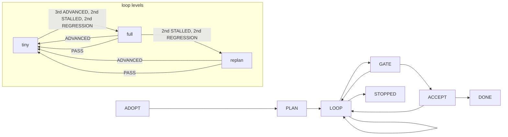

# CheapGPT

CheapGPT installs a **project-local** orchestration policy into a repository, for Codex or for Claude Code. The goal is the fewest expensive tokens per correct change. The strongest model in the profile writes the plan; the root orchestrates, integrates and verifies without writing code. A dynamic builder takes every task that needs judgment, and a mechanical builder takes every task the plan fully determines. Every step starts with a prevent: a step back on the whole, then the next action written whole as one block. Every build is a tiny loop: a prevent, the builders in parallel, a merge, a real run and a review (the root's on known work, a fresh reviewer's on unknown work). A loop that keeps failing escalates from the root to a fresh loop-breaker, then to a re-plan that you approve. An engine, `.cheapgpt/cheapgpt.mjs`, runs the flow defined in `.cheapgpt/flow.json`: what can be computed (states, outcomes, the escalation ladder, the evidence each step owes) is checked by code; the detailed instructions for each state and each sub-agent are small cards in `.cheapgpt/cards/`; the prompt keeps the big picture and the judgment.

This is **not** a global install. It never writes `~/.codex` or `~/.claude`, does **not** change other repositories, and does **not** apply to every thread on your machine. It only mutates the target project folder you pass as `--project`. Every repository that should use CheapGPT needs its own install. If you start a new repo tomorrow, install CheapGPT there again.

Do **not** copy-paste profile text by hand. LLMs drift, summarize, and "fix" wording. Always run `install.mjs` so markers, hashes, and uninstall still work.

## Editions

One repository, one branch (`main`), three editions. `--edition` picks one at install; `update`, `doctor` and `uninstall` keep the edition the project has. A plain `install` without `--edition` installs `codex`.

| Edition | Harness | Instruction file | Builders | Profiles |
| --- | --- | --- | --- | --- |
| `codex` (default) | Codex: the root and every role | `AGENTS.md` | Codex children (`gpt-6.1-terra`, `gpt-6-luna`) | `cheap`, `cheap-100`, `ultracheap` (legacy) |
| `claude` | Claude Code: the root and every role, as native subagents | `CLAUDE.md` | Claude subagents (Sonnet, Haiku) | `cheap`, `cheap-100` |
| `exp` | Claude Code root, planner and reviewers; builders as Codex CLI sessions | `CLAUDE.md` | `codex exec` sessions (`gpt-6.1-terra`, `gpt-6-luna`) | `cheap`, `cheap-100` |

The engine, its flow and its cards are the same in every edition. Until 1.10.3 each edition had its own branch (`main`, `claude-edition`, `exp`); those branches are frozen at 1.10.3. A project installed from one of them updates from `main` and keeps its edition.

## For AI coding agents (Codex, Claude Code, Cursor, OpenCode)

If a human asked you to install CheapGPT into the **current** project:

1. This policy applies only to the current project directory. Never install into the user's home config and never treat it as a global skill.
2. Ask which edition (the harness they use) and which profile, if they did not say. Recommend from the tables below.
3. Locate this CheapGPT checkout (clone it if needed). The installer reads `editions/` next to `install.mjs`; do not pipe the script from curl.
4. Run the installer with Node 18+ from the **target project** as `--project`:

```bash
node /path/to/cheapGPT/install.mjs install --project . --edition codex --profile cheap
```

Windows PowerShell:

```powershell
node C:\path\to\cheapGPT\install.mjs install --project . --edition codex --profile cheap
```

5. Do not edit `AGENTS.md` or `CLAUDE.md` yourself to insert the prompt. Do not install more than one profile. Do not dump all profiles into context.
6. After install or update, tell the human what the harness needs:
   - `codex`: trust this project in Codex, review `/hooks`, and switch the root model to the profile's recommended root (`cheap`: `gpt-6.1-sol` medium; `cheap-100`: `gpt-6.1-sol` xhigh). An already-running Codex root continues if it differs.
   - `claude` and `exp`: open the project in Claude Code, accept the workspace trust dialog, review `/hooks`, and set the root with `/model` (`cheap`: Opus 5.5 medium; `cheap-100`: Opus 5.5 high on `claude`, medium on `exp`). The committed `.claude/` config works in the CLI, desktop, and web sessions.

### Update an existing CheapGPT install

If this project already has a CheapGPT managed block or `.cheapgpt/state.json`, do **not** copy new prompt text by hand. `update` replaces only CheapGPT-owned files (the managed block, `.cheapgpt/`, and CheapGPT hook entries and script) and preserves user-owned instructions outside the markers. It keeps the project's edition, including projects installed from the old edition branches. Installs of the retired `cheap-5x` and `cheap-20x` profiles move to `cheap-100` on `update`.

```bash
node /path/to/cheapGPT/install.mjs update --project . --dry-run
node /path/to/cheapGPT/install.mjs update --project .
node /path/to/cheapGPT/install.mjs doctor --project .
```

Stop before writing if markers are malformed or `update` reports a hand-modified managed block (review, then `--force` only if intended). After a successful update, tell the human to re-review/trust `/hooks` because the hook definition hash changed, recommend the profile's root model (step 6), then start a fresh turn. `doctor` validates installed files against this checkout; it is not evidence that the harness executed a heartbeat on a given turn. To change a project's edition, `uninstall` it, then `install --edition <name>`; `update` refuses a different edition.

## What it does

CheapGPT owns exactly one bounded block in the target repo's instruction file (`AGENTS.md` for `codex`, `CLAUDE.md` for `claude` and `exp`):

```html
<!-- cheapgpt:managed:start -->
...one active profile...
<!-- cheapgpt:managed:end -->
```

Everything outside that block is the user's. Install/update replace only the CheapGPT block. Uninstall removes only CheapGPT files.

Three layers keep the policy alive:

| Layer | Role |
| --- | --- |
| The managed block | Constitution. The harness already loads the project's instruction file. One profile only. |
| `UserPromptSubmit` hook | Heartbeat. A short per-turn reminder (under 2 KB), not the full profile text. |
| `SessionStart` matcher `compact` | Recovery after compaction: on `codex`, the full current managed block once; on `claude` and `exp`, the turn reminder (Claude Code re-reads `CLAUDE.md` itself). |

Normal turns do **not** re-inject the full prompt. Project-local hooks run only when the harness trusts the project; the instruction file still works if hooks are skipped.

Written into the target project:

```text
.cheapgpt/state.json              # edition data, profile, hashes, hook mode
.cheapgpt/cheapgpt.mjs            # the engine (cheap, cheap-100)
.cheapgpt/flow.json               # its flow: states, guards, ladder, card bindings
.cheapgpt/cards/                  # its cards: one per state, level or sub-agent role

codex:
AGENTS.md                         # bounded CheapGPT block appended or replaced
.codex/config.toml                # project-local MultiAgent V2 wait backstop (+ optional AGENTS.md limit)
.codex/hooks.json                 # CheapGPT entries merged; other hooks kept
.codex/hooks/cheapgpt-turn.mjs    # heartbeat + compact recovery

claude, exp:
CLAUDE.md                         # bounded CheapGPT block appended or replaced
.claude/settings.json             # CheapGPT hook entries merged into "hooks"; other keys kept (exp also allows `codex exec`)
.claude/hooks/cheapgpt-turn.mjs   # heartbeat (UserPromptSubmit) + short compact reminder (SessionStart: compact)
```

While a task runs, `.cheapgpt/cheapgpt.mjs` keeps its record in `cheapgpt/` (the plan, the state and log, a rendered board, call packets and replies, worktrees) and scratch files in `temporary/`. Both are git-excluded and removed when the task is done. The `ultracheap` profile does not use the tool.

## Profiles

Install **exactly one**. They are mutually exclusive.

`codex`:

| Profile | Account | Use when | Root | Dynamic builder | Mechanical builder | Reviewers | Planner and loop-breaker |
| --- | --- | --- | --- | --- | --- | --- | --- |
| `cheap` | ChatGPT Plus | Medium-hard tasks | sol-6.1-medium (`gpt-6.1-sol` medium) | `gpt-6.1-terra` medium | `gpt-6-luna` max | `gpt-6.1-sol` medium | `gpt-6.1-sol` xhigh |
| `cheap-100` | ChatGPT Pro | Hardest tasks | sol-6.1-xhigh (`gpt-6.1-sol` xhigh) | `gpt-6.1-terra` max | `gpt-6-luna` max | `gpt-6.1-sol` xhigh | `gpt-6-astra` xhigh |
| `ultracheap` (legacy) | ChatGPT Plus | Simple tasks | luna-6-max (`gpt-6-luna` max) | — (root implements) | — | `gpt-6-luna` max | fresh `gpt-6.1-sol` medium replanner |

`claude`:

| Profile | Use when | Root | Dynamic builder | Mechanical builder | Reviewers | Planner and loop-breaker |
| --- | --- | --- | --- | --- | --- | --- |
| `cheap` | medium-hard tasks | opus-5.5-medium | Sonnet 5.5 medium | Haiku 5.5 xhigh | Opus 5.5 medium | Opus 5.5 xhigh |
| `cheap-100` | hardest tasks | opus-5.5-high | Sonnet 5.5 xhigh | Haiku 5.5 xhigh | Opus 5.5 high | Fable 5.1 xhigh |

`exp`:

| Profile | Root | Dynamic builder | Mechanical builder | Reviewers | Planner and loop-breaker |
| --- | --- | --- | --- | --- | --- |
| `cheap` | opus-5.5-medium | `gpt-6.1-terra` medium | `gpt-6-luna` max | Opus 5.5 medium | Opus 5.5 xhigh |
| `cheap-100` | opus-5.5-medium | `gpt-6.1-terra` max | `gpt-6-luna` max | Opus 5.5 medium | Fable 5.1 xhigh |

`ultracheap` is a **legacy** profile of the `codex` edition. It keeps the previous orchestration design and is not maintained against the current flow.

Preferred root is the economical/capability configuration CheapGPT recommends. It does not override the harness's own model identity and is not a prerequisite for execution. If the already-running root differs, work continues without a switch.

On `claude`, every subagent is spawned with Claude Code's native `Agent` tool and an explicit `model` and `effort`; a fork would run on the root's model, so the planner and each builder get a conversation packet with their first assignment and are continued through `SendMessage`, and reviewers and loop-breakers are always new subagents. On `exp`, the planner, reviewers and loop-breakers run the same way, and each builder is one persistent Codex CLI session for the whole task (`codex exec`, then `codex exec resume <thread_id>`), with its packet and output in `cheapgpt/runs/<call-id>/`. `exp` needs `codex` on `PATH` and logged in; its installer allows `Bash(codex exec:*)` in `.claude/settings.json` (uninstall removes it), and `AGENTS.md` must not hold a CheapGPT block, because the Codex sessions would load it as their own policy (`doctor` reports it).

## How a task runs (cheap, cheap-100)

1. **Route.** The root picks a route and states it in one line:
   - DIRECT: one obvious local edit, or a bounded operational task with a known procedure. The root does it, confirms it by the check or the operation's real output, and is done, without the tool, children or board.
   - FOCUSED: known mechanism; the root writes the plan.
   - FULL: unsettled mechanism, unfamiliar tech, costly failure, or any behavior that depends on model output; the planner (the loop-breaker model) writes the plan.
2. **Adopt.** On an existing project the root first steps back over the project and writes down what exists as one block, then records a real baseline run. Each role's model is reported as requested unless the harness's own record shows it, and every review is checked to leave the repository unchanged.
3. **PLAN.** Goals in your words, single-property criteria (CORE or NON-CORE) each with the real run that decides it and its boundary case, plus Backlog and Drop. Criteria only you can judge stay on the list for you. Goals, design and acceptance are drafted together as one block, then split into the acceptance list and the builders' handoffs. The tool refuses a plan that does not trace every criterion to a goal. On existing code a fresh reviewer checks the plan once. The plan freezes when the build starts; after that only a re-plan with you changes it.
4. **BUILD in tiny loops.** Core and non-core criteria are built in the same tiny loops until every one is established. Each loop: a prevent (a short step back, then the loop's work sketched whole as one block, which the builders receive), the dynamic and mechanical builders in parallel in their own worktrees, a merge, a real run and a review: on FOCUSED the root checks the run itself; on FULL a fresh read-only reviewer judges it. The tool computes the outcome (PASS, ADVANCED, STALLED, REGRESSION, BLOCKED) and keeps BASE, the build with the most criteria passing.
5. **Step backs that look at the whole.** Every step back reads all the evidence, names the class of failure and its root cause, considers removal first and checks the evidence shows the real property. The root takes it in a few lines; repeated failures move it to a fresh loop-breaker (a page, from scratch, then it builds alone); repeated failures there move it to a re-plan with you: you comment first, then approve or reject the new plan before anything is built.
6. **Release gate.** Like every step, it starts with a prevent: the tool refuses a step's work until its step back and one-block are recorded. One gate then runs the product end to end on the exact commit a fresh reviewer then judges against every criterion, core and non-core. Criteria that fail go back to tiny loops.
7. **Delivery and issue report.** You get the split acceptance table, the criteria left to you with what to try, and the gated commit. After a task that needed a full step back or a re-plan, the root may draft a universal, project-neutral issue for this repo, filed only if you say yes.

## Install / update / doctor / uninstall

Requires Node 18+ and a checkout of this repo (so `editions/` and the engine files sit beside `install.mjs`). No npm publish, no `npm install`, no global CLI. To pin a release, clone its tag: `git clone --branch v<version> https://github.com/Lycvrgvs/cheapGPT`.

```bash
node /path/to/cheapGPT/install.mjs install --project . --edition claude --profile cheap
node /path/to/cheapGPT/install.mjs update --project .
node /path/to/cheapGPT/install.mjs update --project . --profile cheap-100
node /path/to/cheapGPT/install.mjs doctor --project .
node /path/to/cheapGPT/install.mjs uninstall --project .
```

Useful flags:

```text
--edition codex|claude|exp
                the edition to install (default codex); update, doctor and uninstall keep the project's own
--dry-run       validate and print the plan; write nothing
--force         overwrite a CheapGPT block you edited by hand
--json          machine-readable output
--no-hooks      instruction file only (no heartbeat/recovery hooks)
--hooks         install hooks (default)
--agents-md-limit 96k|default   (codex)
                raise Codex's AGENTS.md read limit for this project to 96 KiB, or restore 32 KiB
```

### Large AGENTS.md files (codex)

Codex reads at most 32 KiB of `AGENTS.md` per project (`project_doc_max_bytes`) and silently drops the rest. The cheap profiles take about 18 KB, so a long `AGENTS.md` of your own can push CheapGPT's rules past the cut. `doctor` warns when that happens. Fix it with:

```bash
node /path/to/cheapGPT/install.mjs update --project . --agents-md-limit 96k
```

This writes `project_doc_max_bytes = 98304` into the project's `.codex/config.toml` (Codex applies it to trusted projects). `--agents-md-limit default` removes it, and so does `uninstall`.

`--global` is rejected on purpose.

If you hand-edit the managed block, `doctor` fails and `update`/`uninstall` refuse until `--force`.

## The flow

The engine's states and its loop levels, generated from `flow.json`. The profile's CARDS index says which card each state and each sub-agent loads.

<!-- flow:start (generated from flow.json by tools/flow-diagram.mjs; do not edit) -->

<!-- flow:end -->

## Using cheapGPT builders with cLoop

cheapGPT and [cLoop](https://github.com/Lycvrgvs/cLoop) are never installed in the same project: each is a complete orchestration policy, and two would compete for the same root. To have cLoop's council run the process while cheapGPT's economical builders do the building, install cLoop alone with its `--builders cheap` or `--builders cheap-100` option. cLoop reads the builder models from the roles table each cheapGPT edition publishes at `editions/<edition>/profiles/roles.json`.

| cheapGPT edition | Matching cLoop branch |
| --- | --- |
| `codex` | `codex` |
| `exp` | `main` |
| `claude` | `claude` |

If cLoop is already installed in a project, `install` and `update` stop before writing anything and print both choices: keep cLoop with cheapGPT's builders, or uninstall cLoop and keep cheapGPT.

## Tests

```bash
node --test test/editions.test.mjs test/installer-codex.test.mjs test/installer-claude.test.mjs test/cheapgpt.test.mjs test/repo.test.mjs
```

The installer suites run every edition (`installer-claude` covers `claude` and `exp`, which share the Claude Code installer); the engine suite runs once.

## Layout

```text
install.mjs                       the entry point: picks the edition, then runs that edition's installer
cheapgpt.mjs                      the engine, installed into each project as .cheapgpt/cheapgpt.mjs (every edition)
flow.json                         the flow as data: states, transitions, guards, ladder, card bindings
cards/                            the cards: one per state, level or sub-agent role
cloop-guard.mjs                   stops install/update when cLoop is present
editions/codex/install.mjs        the Codex installer (AGENTS.md, .codex/)
editions/codex/codex-config.mjs   its .codex/config.toml edits
editions/codex/hooks/             its turn hook, copied into .codex/hooks/
editions/claude/install.mjs       the Claude Code installer (CLAUDE.md, .claude/), for claude and exp
editions/claude/hooks/            its turn hook, copied into .claude/hooks/
editions/<edition>/profiles/      each edition's profiles, catalog.json (metadata + turn reminder) and roles.json
tools/roles.mjs                   writes each edition's roles.json from its profiles (--check verifies)
tools/flow-diagram.mjs            the README flow diagram, generated from flow.json
test/installer-codex.test.mjs     the codex installer
test/installer-claude.test.mjs    the Claude Code installer, run for claude and for exp
test/cheapgpt.test.mjs            every guard of the engine, seen refusing and passing
test/repo.test.mjs                flow.json, cards/ and the README diagram agree
test/editions.test.mjs            the entry point: edition choice, inference and refusal
```
