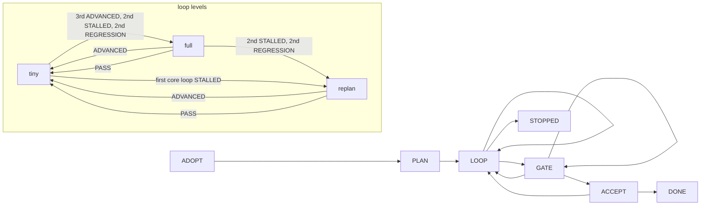

# CheapGPT

CheapGPT installs a **project-local** Codex orchestration policy into a repository's root `AGENTS.md`. The goal is the fewest expensive tokens per correct change. The strongest model in the profile writes the plan; the root orchestrates, integrates and verifies without writing code. A dynamic builder (gpt-6.1-terra) takes every task that needs judgment, and a mechanical builder (gpt-6-luna) takes every task the plan fully determines. Every build is a tiny loop: a step back, the builders in parallel, a merge, a real run and a fresh review. A loop that keeps failing escalates from the root to a fresh loop-breaker, then to a re-plan that you approve. An engine, `.cheapgpt/cheapgpt.mjs`, runs the flow defined in `.cheapgpt/flow.json`: what can be computed (states, outcomes, the escalation ladder, the evidence each step owes) is checked by code; the detailed instructions for each state and each sub-agent are small cards in `.cheapgpt/cards/`; the prompt keeps the big picture and the judgment.

This is **not** a global Codex install. It does **not** write `~/.codex`, does **not** change other repositories, and does **not** apply to every thread on your machine. It only mutates the target project folder you pass as `--project`. Every repository, worktree, or project that should use CheapGPT needs its own install into **that folder's** `AGENTS.md` (and that folder's `.codex/` hooks). If you start a new repo tomorrow, install CheapGPT there again.

Do **not** copy-paste profile text by hand. LLMs drift, summarize, and "fix" wording. Always run `install.mjs` so markers, hashes, and uninstall still work.

## For AI coding agents (Codex, Claude Code, Cursor, OpenCode)

If a human asked you to install CheapGPT into the **current** project:

1. This policy applies only to the current project directory. Never install into the user's home Codex config and never treat it as a global skill.
2. Ask which profile to use if they did not name one. Recommend from the table below.
3. Locate this CheapGPT checkout (clone it if needed). Profiles live next to `install.mjs`; do not pipe the script from curl without the `profiles/` directory.
4. Run the installer with Node 18+ from the **target project** as `--project`:

```bash
node /path/to/cheapGPT/install.mjs install --project . --profile cheap
```

Windows PowerShell:

```powershell
node C:\path\to\cheapGPT\install.mjs install --project . --profile cheap
```

5. Do not edit `AGENTS.md` yourself to insert the prompt. Do not install more than one profile. Do not dump all profiles into context.
6. After install or update, tell the human: trust this project in Codex, review `/hooks`, and switch the root model to the profile's recommended root (`cheap`: `gpt-6.1-sol` medium; `cheap-100`: `gpt-6.1-sol` xhigh). An already-running Codex root continues if it differs.

### Update an existing CheapGPT install

If this project already has a CheapGPT managed block or `.cheapgpt/state.json`, do **not** copy new prompt text by hand. `update` replaces only CheapGPT-owned files (the managed `AGENTS.md` block, `.cheapgpt/state.json`, and CheapGPT hook entries/script) and preserves user-owned instructions outside the markers. Installs of the retired `cheap-5x` and `cheap-20x` profiles move to `cheap-100` on `update`.

```bash
node /path/to/cheapGPT/install.mjs update --project . --dry-run
node /path/to/cheapGPT/install.mjs update --project .
node /path/to/cheapGPT/install.mjs doctor --project .
```

Stop before writing if markers are malformed or `update` reports a hand-modified managed block (review, then `--force` only if intended). After a successful update, tell the human to re-review/trust `/hooks` because the hook definition hash changed, recommend the profile's root model (step 6), then start a fresh turn. `doctor` validates installed files against this checkout; it is not evidence that Codex executed a heartbeat on a given turn.

Sibling checkout example (CheapGPT next to the app):

```bash
node ../cheapGPT/install.mjs --project . --profile cheap
```

## What it does

CheapGPT owns exactly one bounded block in the target repo:

```html
<!-- cheapgpt:managed:start -->
...one active profile...
<!-- cheapgpt:managed:end -->
```

Everything outside that block is the user's. Install/update replace only the CheapGPT block. Uninstall removes only CheapGPT files.

Three layers keep the policy alive in Codex:

| Layer | Role |
| --- | --- |
| `AGENTS.md` managed block | Constitution. Codex already loads project `AGENTS.md`. One profile only. |
| `UserPromptSubmit` hook | Heartbeat. A short per-turn reminder (under 1 KB for cheap profiles), not the full profile text. |
| `SessionStart` matcher `compact` | Recovery. After compaction, rehydrates the full current managed block once. |

Normal turns do **not** re-inject the full prompt. Project-local hooks run only when Codex trusts the project; `AGENTS.md` still works if hooks are skipped.

Written into the target project:

```text
AGENTS.md                         # bounded CheapGPT block appended or replaced
.cheapgpt/state.json              # profile, hashes, hook mode
.cheapgpt/cheapgpt.mjs            # the engine (cheap, cheap-100)
.cheapgpt/flow.json               # its flow: states, guards, ladder, card bindings
.cheapgpt/cards/                  # its cards: one per state, level or sub-agent role
.codex/config.toml                # project-local MultiAgent V2 wait backstop (+ optional AGENTS.md limit)
.codex/hooks.json                 # CheapGPT entries merged; other hooks kept
.codex/hooks/cheapgpt-turn.mjs    # heartbeat + compact recovery
```

While a task runs, `.cheapgpt/cheapgpt.mjs` keeps its record in `cheapgpt/` (the plan, the state and log, a rendered board, call packets and replies, worktrees) and scratch files in `temporary/`. Both are git-excluded and removed when the task is done. The `ultracheap` profile does not use the tool.

## Profiles

Install **exactly one**. They are mutually exclusive.

| Profile | Account | Use when | Root | Dynamic builder | Mechanical builder | Reviewers | Planner and loop-breaker |
| --- | --- | --- | --- | --- | --- | --- | --- |
| `cheap` | ChatGPT Plus | Medium-hard tasks | sol-6.1-medium (`gpt-6.1-sol` medium) | `gpt-6.1-terra` medium | `gpt-6-luna` max | `gpt-6.1-sol` medium | `gpt-6.1-sol` xhigh |
| `cheap-100` | ChatGPT Pro | Hardest tasks | sol-6.1-xhigh (`gpt-6.1-sol` xhigh) | `gpt-6.1-terra` max | `gpt-6-luna` max | `gpt-6.1-sol` xhigh | `gpt-6-astra` xhigh |
| `ultracheap` (legacy) | ChatGPT Plus | Simple tasks | luna-6-max (`gpt-6-luna` max) | — (root implements) | — | `gpt-6-luna` max | fresh `gpt-6.1-sol` medium replanner |

`ultracheap` is a **legacy** profile. It keeps the previous orchestration design and is not maintained against the current flow. A new ultracheap flow will be released once good cheap models and big models at a decent price make it viable.

Preferred root is the economical/capability configuration CheapGPT recommends. It does not override Codex's harness/system model identity and is not a prerequisite for execution. If the already-running root differs, work continues without a switch.

## How a task runs (cheap, cheap-100)

1. **Route.** The root picks a route and states it in one line:
   - DIRECT: one obvious local edit, or a bounded operational task with a known procedure. The root does it, confirms it by the check or the operation's real output, and is done, without the tool, children or board.
   - FOCUSED: known mechanism; the root writes the plan.
   - FULL: unsettled mechanism, unfamiliar tech, costly failure, or any behavior that depends on model output; the planner (the loop-breaker model) writes the plan.
2. **Adopt.** On an existing project the root first records a real baseline run. Each role's model is reported as requested unless the harness's own record shows it, and every review is checked to leave the repository unchanged.
3. **PLAN.** Goals in your words, single-property criteria (CORE or NON-CORE) each with the real run that decides it and its boundary case, plus Backlog and Drop. Criteria only you can judge stay on the list for you. The tool refuses a plan that does not trace every criterion to a goal. On existing code a fresh reviewer checks the plan once.
4. **BUILD in tiny loops.** Every build is a tiny loop: a step back, the dynamic and mechanical builders in parallel in their own worktrees, a merge, a real run and a fresh read-only review. The tool computes the outcome (PASS, ADVANCED, STALLED, REGRESSION, BLOCKED) and keeps BASE, the build with the most criteria passing.
5. **Step backs that look at the whole.** Every step back reads all the evidence, names the class of failure and its root cause, considers removal first and checks the evidence shows the real property. The root takes it in a few lines; repeated failures move it to a fresh loop-breaker (a few paragraphs, then it builds alone); repeated failures there move it to a re-plan with you, which you approve before anything is built.
6. **Gates.** A core gate and a release gate each run the product end to end on the exact commit a fresh reviewer then judges. The acceptance list freezes when the core gate passes.
7. **Delivery and issue report.** You get the split acceptance table, the criteria left to you with what to try, and the gated commit. After a task that needed a full step back or a re-plan, the root may draft a universal, project-neutral issue for this repo, filed only if you say yes.

## Install / update / doctor / uninstall

Requires Node 18+ and a checkout of this repo (so `profiles/` and `hooks/` sit beside `install.mjs`). No npm publish, no `npm install`, no global CLI.

```bash
node /path/to/cheapGPT/install.mjs install --project . --profile cheap
node /path/to/cheapGPT/install.mjs update --project .
node /path/to/cheapGPT/install.mjs update --project . --profile cheap-100
node /path/to/cheapGPT/install.mjs doctor --project .
node /path/to/cheapGPT/install.mjs uninstall --project .
```

Useful flags:

```text
--dry-run       validate and print the plan; write nothing
--force         overwrite a CheapGPT block you edited by hand
--json          machine-readable output
--no-hooks      AGENTS.md only (no Codex heartbeat/recovery)
--hooks         install hooks (default)
--agents-md-limit 96k|default
                raise Codex's AGENTS.md read limit for this project to 96 KiB, or restore 32 KiB
```

### Large AGENTS.md files

Codex reads at most 32 KiB of `AGENTS.md` per project (`project_doc_max_bytes`) and silently drops the rest. The cheap profiles take about 18 KB, so a long `AGENTS.md` of your own can push CheapGPT's rules past the cut. `doctor` warns when that happens. Fix it with:

```bash
node /path/to/cheapGPT/install.mjs update --project . --agents-md-limit 96k
```

This writes `project_doc_max_bytes = 98304` into the project's `.codex/config.toml` (Codex applies it to trusted projects). `--agents-md-limit default` removes it, and so does `uninstall`.

`--global` is rejected on purpose.

If you hand-edit the managed block, `doctor` fails and `update`/`uninstall` refuse until `--force`.

## Branches

- `main`: this Codex edition.
- `claude-edition`: the same flow for Claude Code (CLAUDE.md, native subagents).
- `exp`: experimental, with a Claude Code root and the dynamic and mechanical builders running as Codex CLI sessions.

## The flow

The engine's states and its loop levels, generated from `flow.json`. The profile's CARDS index says which card each state and each sub-agent loads.

<!-- flow:start (generated from flow.json by tools/flow-diagram.mjs; do not edit) -->

<!-- flow:end -->

## Using cheapGPT builders with cLoop

cheapGPT and [cLoop](https://github.com/Lycvrgvs/cLoop) are never installed in the same project: each is a complete orchestration policy, and two would compete for the same root. To have cLoop's council run the process while cheapGPT's economical builders do the building, install cLoop alone with its `--builders cheap` or `--builders cheap-100` option (from cLoop's next release). cLoop reads the builder models from `profiles/roles.json`, which every cheapGPT branch publishes.

| cheapGPT branch | Matching cLoop branch |
| --- | --- |
| `main` | `codex` |
| `exp` | `main` |
| `claude-edition` | `claude` |

This branch pairs with cLoop's `codex` branch. If cLoop is already installed in a project, `install` and `update` stop before writing anything and print both choices: keep cLoop with cheapGPT's builders, or uninstall cLoop and keep cheapGPT.

## Tests

```bash
node --test test/installer.test.mjs test/cheapgpt.test.mjs test/repo.test.mjs
```

## Layout

```text
install.mjs              zero-dependency installer (node:fs, node:crypto, node:path)
profiles/*.md            canonical opaque profile policies
profiles/catalog.json    profile metadata + heartbeat turn reminder
profiles/roles.json      published roles table for cLoop (generated by tools/roles.mjs)
cloop-guard.mjs          stops install/update when cLoop is present
tools/roles.mjs          roles.json generator
cheapgpt.mjs             the engine, installed into each project as .cheapgpt/cheapgpt.mjs
flow.json                the flow as data: states, transitions, guards, ladder, card bindings
cards/                   the cards: one per state, level or sub-agent role
tools/flow-diagram.mjs   the README flow diagram, generated from flow.json
test/cheapgpt.test.mjs   every guard of the engine, seen refusing and passing
test/repo.test.mjs       flow.json, cards/ and the README diagram agree
hooks/cheapgpt-turn.mjs  copied into each target project's .codex/hooks/
test/installer.test.mjs
```