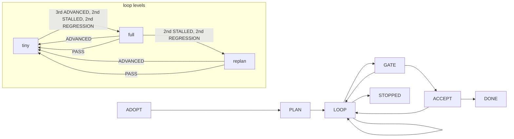

# CheapGPT — Claude Code edition

CheapGPT installs a **project-local** Claude Code orchestration policy into a repository's root `CLAUDE.md`. The goal is the fewest expensive tokens per correct change. The strongest model in the profile writes the plan; the Opus root orchestrates, integrates and verifies without writing code. A dynamic builder (Sonnet) takes every task that needs judgment, and a mechanical builder (Haiku) takes every task the plan fully determines. Every step starts with a prevent: a step back on the whole, then the next action written whole as one block. Every build is a tiny loop: a prevent, the builders in parallel, a merge, a real run and a review (the root's on known work, a fresh reviewer's on unknown work). A loop that keeps failing escalates from the root to a fresh loop-breaker, then to a re-plan that you approve. An engine, `.cheapgpt/cheapgpt.mjs`, runs the flow defined in `.cheapgpt/flow.json`: what can be computed (states, outcomes, the escalation ladder, the evidence each step owes) is checked by code; the detailed instructions for each state and each sub-agent are small cards in `.cheapgpt/cards/`; the prompt keeps the big picture and the judgment. This branch is the Claude Code edition; `main` is the Codex edition.

It is **not** a global install. It never writes `~/.claude` and only mutates the target project folder you pass as `--project`. Every repository that should use CheapGPT needs its own install. Do not copy-paste profile text by hand; always run `install.mjs` so markers, hashes, and uninstall keep working.

## Install / update / doctor / uninstall

Requires Node 18+ and a checkout of this branch (so `profiles/` and `hooks/` sit beside `install.mjs`).

```bash
node /path/to/cheapGPT/install.mjs install --project . --profile cheap
node /path/to/cheapGPT/install.mjs update --project .
node /path/to/cheapGPT/install.mjs doctor --project .
node /path/to/cheapGPT/install.mjs uninstall --project .
```

Flags: `--dry-run`, `--force` (overwrite a hand-edited CheapGPT block), `--json`, `--no-hooks`, `--hooks` (default). `--global` is rejected.

After install or update, open the project in Claude Code, accept the workspace trust dialog, review `/hooks`, and set the root model to the profile's recommended root with `/model` (`cheap`: Opus 5.5 medium; `cheap-100`: Opus 5.5 high). The committed `.claude/` config works in the CLI, desktop, and web sessions.

## What it writes

```text
CLAUDE.md                          # bounded CheapGPT block appended or replaced
.cheapgpt/state.json               # profile, hashes, hook mode
.cheapgpt/cheapgpt.mjs             # the engine
.cheapgpt/flow.json                # its flow: states, guards, ladder, card bindings
.cheapgpt/cards/                   # its cards: one per state, level or sub-agent role
.claude/settings.json              # CheapGPT hook entries merged into "hooks"; other keys kept
.claude/hooks/cheapgpt-turn.mjs    # heartbeat (UserPromptSubmit) + short compact reminder (SessionStart: compact)
```

Claude Code re-reads the project-root `CLAUDE.md` after compaction, so the compact hook injects only the turn reminder, never the whole block. While a task runs, `.cheapgpt/cheapgpt.mjs` keeps its record in `cheapgpt/` (the plan, the state and log, a rendered board, call packets and replies, worktrees) and scratch files in `temporary/`. Both are git-excluded and removed when the task is done.

## Profiles

Install **exactly one**.

| Profile | Use when | Root | Dynamic builder | Mechanical builder | Reviewers | Planner and loop-breaker |
| --- | --- | --- | --- | --- | --- | --- |
| `cheap` | medium-hard tasks | opus-5.5-medium | Sonnet 5.5 medium | Haiku 5.5 xhigh | Opus 5.5 medium | Opus 5.5 xhigh |
| `cheap-100` | hardest tasks | opus-5.5-high | Sonnet 5.5 xhigh | Haiku 5.5 xhigh | Opus 5.5 high | Fable 5.1 xhigh |

There is no `ultracheap` on this branch; it remains a legacy Codex profile on `main`.

Every subagent is spawned with Claude Code's native `Agent` tool and an explicit `model` and `effort`. A fork would run on the root's model, so implementers can't inherit the root conversation. Instead, the planner and each implementer get a conversation packet with their first assignment and are continued through `SendMessage`. Reviewers and loop-breakers are always new subagents.

The flow is the same as on `main`:

1. **Route.** The root picks a route and states it in one line:
   - DIRECT: one obvious local edit, or a bounded operational task with a known procedure. The root does it, confirms it by the check or the operation's real output, and is done, without the tool, children or board.
   - FOCUSED: known mechanism; the root writes the plan.
   - FULL: unsettled mechanism, unfamiliar tech, costly failure, or any behavior that depends on model output; the planner (the loop-breaker model) writes the plan.
2. **Adopt.** On an existing project the root first steps back over the project, records a real baseline run and writes down what exists as one block. Each role's model is reported as requested unless the harness's own record shows it, and every review is checked to leave the repository unchanged.
3. **PLAN.** Goals in your words, single-property criteria (CORE or NON-CORE) each with the real run that decides it and its boundary case, plus Backlog and Drop. Criteria only you can judge stay on the list for you. Goals, design and acceptance are drafted together as one block, then split into the acceptance list and the builders' handoffs. The tool refuses a plan that does not trace every criterion to a goal. On existing code a fresh reviewer checks the plan once. The plan freezes when the build starts; after that only a re-plan with you changes it.
4. **BUILD in tiny loops.** Core and non-core criteria are built in the same tiny loops until every one is established. Each loop: a prevent (a short step back, then the loop's work sketched whole as one block, which the builders receive), the dynamic and mechanical builders in parallel in their own worktrees, a merge, a real run and a review: on FOCUSED the root checks the run itself; on FULL a fresh read-only reviewer judges it. The tool computes the outcome (PASS, ADVANCED, STALLED, REGRESSION, BLOCKED) and keeps BASE, the build with the most criteria passing.
5. **Step backs that look at the whole.** Every step back reads all the evidence, names the class of failure and its root cause, considers removal first and checks the evidence shows the real property. The root takes it in a few lines; repeated failures move it to a fresh loop-breaker (a page, from scratch, then it builds alone); repeated failures there move it to a re-plan with you: you comment first, then approve or reject the new plan before anything is built.
6. **Release gate.** One gate runs the product end to end on the exact commit a fresh reviewer then judges against every criterion, core and non-core. Criteria that fail go back to tiny loops.
7. **Delivery and issue report.** You get the split acceptance table, the criteria left to you with what to try, and the gated commit. After a task that needed a full step back or a re-plan, the root may draft a universal, project-neutral issue for this repo, filed only if you say yes.

## The flow

The engine's states and its loop levels, generated from `flow.json`. The profile's CARDS index says which card each state and each sub-agent loads.

<!-- flow:start (generated from flow.json by tools/flow-diagram.mjs; do not edit) -->

<!-- flow:end -->

## Using cheapGPT builders with cLoop

cheapGPT and [cLoop](https://github.com/Lycvrgvs/cLoop) are never installed in the same project: each is a complete orchestration policy, and two would compete for the same root. To have cLoop's council run the process while cheapGPT's economical builders do the building, install cLoop alone with its `--builders cheap` or `--builders cheap-100` option (from cLoop's next release). cLoop reads the builder models from `profiles/roles.json`, which every cheapGPT branch publishes.

| cheapGPT branch | Matching cLoop branch |
| --- | --- |
| `main` | `codex` |
| `exp` | `main` |
| `claude-edition` | `claude` |

This branch pairs with cLoop's `claude` branch. If cLoop is already installed in a project, `install` and `update` stop before writing anything and print both choices: keep cLoop with cheapGPT's builders, or uninstall cLoop and keep cheapGPT.

## Tests

```bash
node --test test/installer.test.mjs test/cheapgpt.test.mjs test/repo.test.mjs
```

## Layout

```text
install.mjs              zero-dependency installer
profiles/*.md            canonical profile policies (Claude Code edition)
profiles/catalog.json    profile metadata and turn reminders
profiles/roles.json      published roles table for cLoop (generated by tools/roles.mjs)
cloop-guard.mjs          stops install/update when cLoop is present
tools/roles.mjs          roles.json generator
cheapgpt.mjs             the engine, installed into each project as .cheapgpt/cheapgpt.mjs
flow.json                the flow as data: states, transitions, guards, ladder, card bindings
cards/                   the cards: one per state, level or sub-agent role
tools/flow-diagram.mjs   the README flow diagram, generated from flow.json
test/cheapgpt.test.mjs   every guard of the engine, seen refusing and passing
test/repo.test.mjs       flow.json, cards/ and the README diagram agree
hooks/cheapgpt-turn.mjs  copied into each target project's .claude/hooks/
test/installer.test.mjs
```